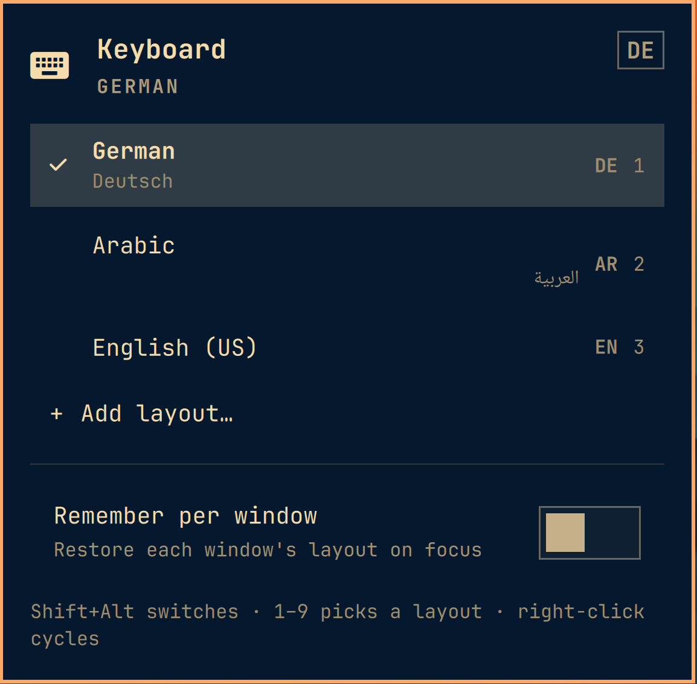

# Keyboard Switcher

A Windows/macOS-style language switcher for the Omarchy bar — and better.
Click the pill for a full layout list, right-click or scroll to cycle,
`Shift+Alt` to switch from the keyboard, `SUPER+SHIFT+L` to summon the panel.

- **Pill**: `DE / AR` always in Latin briefs
- **Panel**: full names + native names, `1–9` to jump, arrows + Enter
- **Right-click / scroll**: instant cycle without opening anything
- **Remember per window** (opt-in): each window restores its layout on focus
- **Flash on switch**: OSD toast on every layout change, keyboard or click
- **Manage layouts in the panel**: `+ Add layout…` searches the full xkb
  catalog (700+ layouts, variants included — far beyond the setup menu's
  shortlist); × on a row removes it. Changes persist to
  `~/.config/hypr/input.lua` and apply live via `hyprctl reload`.

## Screenshots

| Bar pill | Panel |
|---|---|
|  |  |

## Install

```bash
omarchy plugin add https://github.com/rubar/keyboard-switcher.git --enable
```

Optional: summon the panel from the keyboard by adding to
`~/.config/hypr/bindings.lua`:

```lua
o.bind("SUPER + SHIFT + L", "Keyboard switcher", "omarchy-shell -q rubar.keyboard-layout toggle")
```

## Usage

- **Left-click** the bar pill → open the layout panel
- **Right-click / scroll** → instant cycle to the next layout
- **Shift+Alt** → switch from the keyboard (with OSD toast)
- **1–9** in the panel → jump straight to a layout
- **+ Add layout…** → search the full xkb catalog and add (variants too);
  × on a row removes it (visible while adding)

## How it works

Reads the live seat via `hyprctl -j devices` (all keyboards sharing the
layout list switch together) and resolves friendly names from
`xkbcli list --load-exotic`. Layout adds/removes go through
`layouts-apply.py`, which rewrites the active `kb_layout`/`kb_variant` lines
in `~/.config/hypr/input.lua`, refuses non-Latin lead layouts (they would
break Super bindings), and reloads Hyprland with config-error checking.

Per-window memory lives in `~/.local/state/omarchy/keyboard-switcher.json`,
so window churn never dirties your config. Settings persist inline in
`shell.json` under the `rubar.keyboard-layout` entry.

## Requirements

- Omarchy Linux (Hyprland + Quickshell shell)
- Two or more keyboard layouts (the widget hides itself with one)

## Remove

```bash
omarchy plugin remove rubar.keyboard-layout
```

## License

MIT
